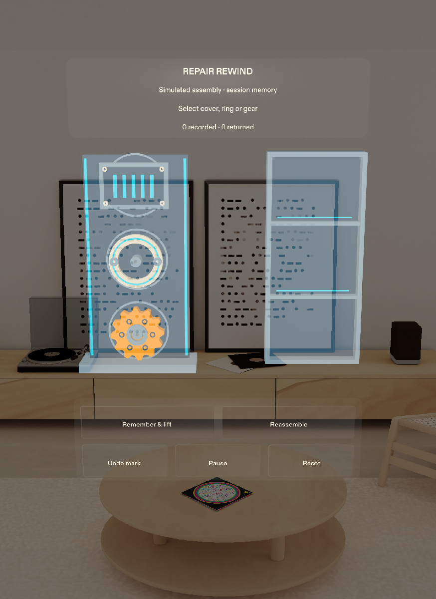

# Repair Rewind

**Remember how it came apart.** A new SPECS Lens for Learn AR with SPECS, started 22 October 2026.

Repair Rewind turns a disassembly into a spatial memory you can walk backwards. Mark a part before removing it; its numbered breadcrumb stays at the original position. When you return, the next part and its destination light up together. You confirm each return.

The first demonstration uses a clearly labelled simulated mechanical assembly with a cover, retaining ring and gear. It demonstrates explicit user recording and reverse-order guidance within one session. It does not claim object recognition, automatic correctness checking, repair diagnosis or persistent spatial anchors.

## Project state

Repair Rewind is a working Lens Studio Preview prototype for makers and repair learners. In the simulated cover, retaining ring and gear assembly, you record each part’s original place and sequence, then retrace those observations in reverse. Each return requires confirmation. Pause, Back and confirmed Reset make interruptions and mistakes recoverable; an edge cue helps you find a destination outside the current view.

The saved project compiles in Lens Studio 5.24.1 and opens in the normal empty Ready state. Ten standalone tests cover the session engine; seven native scenarios cover interaction and recovery. A fresh source-only copy imported and compiled on the installed development host, then passed the core native scenario and all ten standalone tests. The reviewed 2:20 demonstration contains actual Preview footage, English narration and captions. See [verification status](devpost/verification.md) for the test provenance and limitations. Public repository and video links remain pending publication.

Open `Repair Rewind.esproj` and choose **SPECS 27 → Interactive → Sunlit Room**. Select a part, then choose **Remember & lift**. The prototype uses simulated parts and remembers only the current Lens session.

## Test the session logic

With Node.js 22.6 or later, run `npm test`. No npm dependencies are needed. Tests cover reverse recorded order, immutable pose copies, rejected invalid actions, pause/resume, undo and reset. These tests do not exercise rendering, SIK input, tracking or physical repairs.

## Design and delivery

- [Design brief](devpost/design-brief.md)
- [Native interaction acceptance](devpost/native-acceptance.md)
- [Verification status and limits](devpost/verification.md)
- [Judging strategy and requirements](devpost/hackathon-research.md)
- [Recorded demo sequence](devpost/demo-script.md)
- [Build checkpoint](devpost/BUILD-STATUS.md)
- [Submission copy draft](devpost/submission-draft.md)

## Source provenance

Repair Rewind's original code was created during this challenge. The official SPECS Base Template and its libraries are disclosed in [third-party material](devpost/third-party.md). Planning uses the official [Devpost Learn pack](https://github.com/challengepost/learn-specs); native construction uses [Snap CLAD](https://github.com/lens-studio-devs/ls-extensions).

Keep credentials, `.mcp.json`, local diagnostics, private portfolio content and camera captures out of the public repository. Nothing has been published or submitted by this setup.
